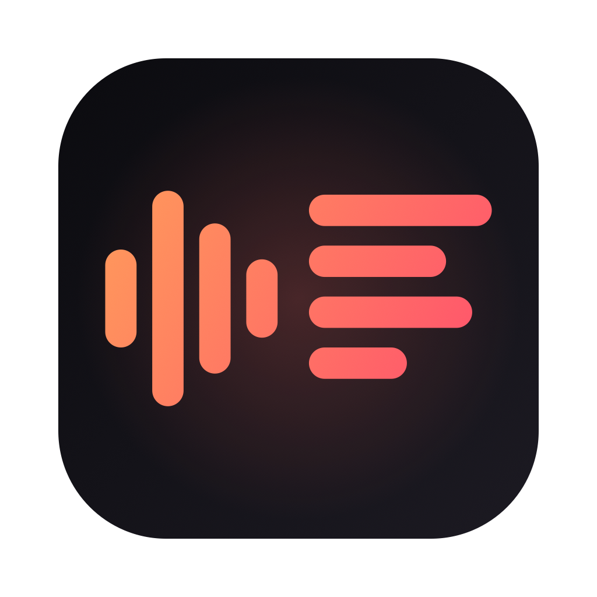
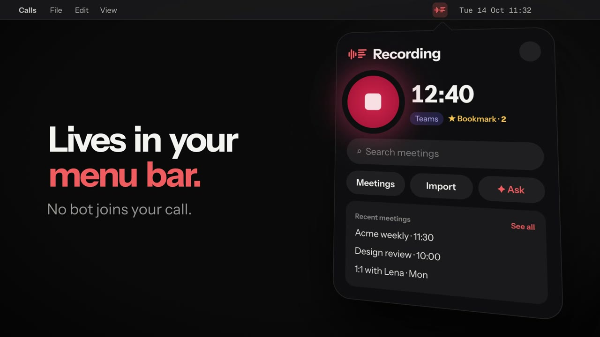
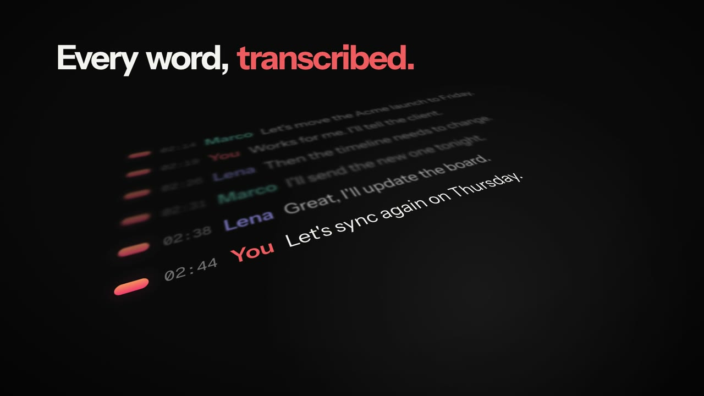
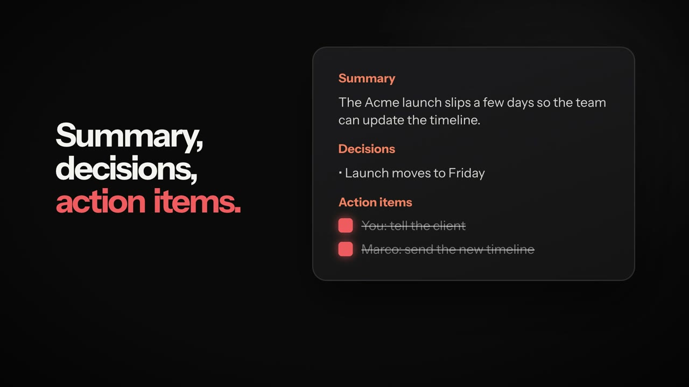
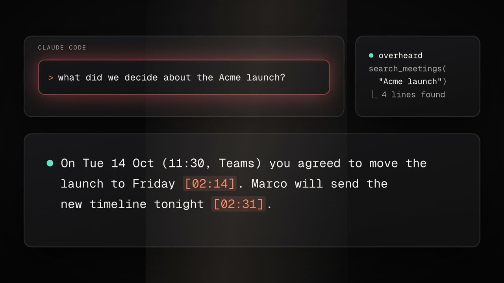

<p align="center">
  
</p>

<h1 align="center">Overheard</h1>

<p align="center">
  <b>Your meetings, turned into text — and answerable from Claude.</b><br>
  A tiny Mac menu bar app that records your calls, transcribes them and makes them searchable from Claude.<br>
  No bot joins your call. No virtual audio driver. Native Swift.
</p>

<p align="center">
  
  
  
  
  <a href="LICENSE"></a>
</p>

<p align="center">
  <a href="docs/overheard.mp4"></a><br>
  <sub><a href="https://getoverheard.dev">getoverheard.dev</a> · <a href="docs/overheard.mp4">▶ Watch with sound</a> · <a href="../../releases/latest">Download</a></sub>
</p>

---

## How it works

<table>
  <tr>
    <td width="50%"></td>
    <td width="50%"></td>
  </tr>
  <tr>
    <td><b>1 · Record.</b> It starts when Meet, Teams or Slack grab the mic. Bookmark moments with <b>⌃⌥M</b>.</td>
    <td><b>2 · Transcribe.</b> Every word, with speakers and timestamps — in the cloud or fully on your Mac.</td>
  </tr>
  <tr>
    <td></td>
    <td></td>
  </tr>
  <tr>
    <td><b>3 · Summarize.</b> Decisions and action items you can tick off.</td>
    <td><b>4 · Ask Claude.</b> <i>"What did we decide about the Acme launch?"</i> — answered from your meetings, with timestamps.</td>
  </tr>
</table>


## Why Overheard

- **Your meetings, inside Claude.** Overheard ships an MCP server: ask Claude Code, Claude Desktop or Codex *"what did we decide in yesterday's standup?"* or *"draft the follow-up email for the Acme call"* and it reads your transcripts.
- **No extra API keys for the AI.** Summaries and chat use the Claude Code or Codex CLI you already have, with your existing subscription.
- **Records the call, not the meeting.** System audio is captured with Core Audio process taps (macOS 14.2+), your voice from the microphone on a separate track. Works with Google Meet, Microsoft Teams, Slack huddles, and anything else that plays audio.
- **Cloud or fully local transcription.** ElevenLabs Scribe for the best accuracy, or Cohere Transcribe running on your Mac's GPU if audio must never leave the machine.

## Features

**Recording**
- Starts automatically when Meet, Teams or Slack start using the microphone (or with one click, or `overheard://toggle`)
- Bookmark important moments while recording with **⌃⌥M** from any app
- Your microphone is leveled to match the call, with optional echo reduction for people who use speakers
- Calendar integration: meetings get the event title and attendees
- Survives device changes (AirPods connecting mid-call, sample rate switches)

**Transcripts**
- Speaker diarization; your own voice is labelled with your name
- Rename speakers, edit lines, click any line to play it back
- Talk-time per speaker, search with highlighting, export audio sections as `.m4a`
- Import audio/video files or links (YouTube, podcasts — via `yt-dlp`) and transcribe them too

**AI**
- Automatic summary with decisions, action items (checkable) and bookmarked moments
- Chat across all your meetings or a single one
- MCP server with `list_meetings`, `search_meetings`, `get_meeting`, `list_action_items` and, if you allow it, actions like starting a recording or checking off a task

**Sharing**
- PDF export, copy summary/transcript, markdown notes with frontmatter for Obsidian, Logseq or Notion

The interface is in English and Italian.

## Install

Requires an **Apple Silicon** Mac with **macOS 14.2** or later (on-device transcription needs **macOS 15**).

1. Download the latest `.dmg` from [Releases](../../releases/latest) and drag **Overheard** to Applications. It is signed and notarized by Apple, so it opens with a double click.
2. Open it: the icon appears in the menu bar. Grant microphone and audio recording access on the first recording.
3. Transcription runs *On this Mac* by default on macOS 15 (downloads ~2.5 GB of models once, no account). For the best accuracy, switch to ElevenLabs in **Settings → Transcription** and paste an API key with the *Speech to Text* permission.
4. Optional: install [Claude Code](https://claude.com/claude-code) or Codex for summaries and chat, then click **Connect to Claude** in Settings to enable the MCP server.

### Build from source

```bash
git clone https://github.com/anonbeat1/overheard.git
cd overheard
./build.sh        # builds the app and the local transcriber, installs to ~/Applications
./package.sh      # optional: creates dist/Overheard-<version>.dmg
```

Needs Xcode 16 or later. The first build downloads and compiles the on-device transcription stack (MLX), which takes a few minutes.

## Where your data lives

Everything stays in `~/Meetings`, one folder per meeting:

```
~/Meetings/2026-10-14_113035/
  recording.wav   call audio
  mic.wav         your microphone
  transcript.md   **[mm:ss] Speaker:** text
  summary.md      summary, decisions, action items
  bookmarks.txt   bookmarked moments (seconds)
```

Plain files, so other tools can read them. Audio is sent to ElevenLabs only if you choose it as the engine; summaries and chat send transcript text to the AI CLI you use. Old meetings can be moved to the Trash automatically after 7–365 days.

## Automation

| URL | Action |
|---|---|
| `overheard://toggle` | start / stop recording |
| `overheard://bookmark` | bookmark the current moment |
| `overheard://meetings` | open the meeting library |
| `overheard://import?url=<link or file>` | import and transcribe |

```bash
open -g overheard://toggle
```

## Please record responsibly

Recording people may require their consent, depending on where you and they are. Tell participants you are recording. You are responsible for complying with the laws that apply to you.

## Credits

- [speech-swift](https://github.com/soniqo/speech-swift) (Apache 2.0) for on-device inference
- [Cohere Transcribe](https://huggingface.co/CohereLabs/cohere-transcribe-03-2026) (Apache 2.0), MLX conversion by [aufklarer](https://huggingface.co/aufklarer/Cohere-Transcribe-2B-MLX-8bit)
- [pyannote speaker-diarization-community-1](https://huggingface.co/pyannote/speaker-diarization-community-1) (CC-BY-4.0) and [segmentation-3.0](https://huggingface.co/pyannote/segmentation-3.0) (MIT) by pyannote, Core ML / MLX conversions by aufklarer
- [ElevenLabs Scribe](https://elevenlabs.io/speech-to-text) for cloud transcription

Not affiliated with Anthropic, OpenAI, Google, Microsoft, Slack or ElevenLabs.

## License

[MIT](LICENSE) © 2026 Gabriele Spilotri Cavaiola
